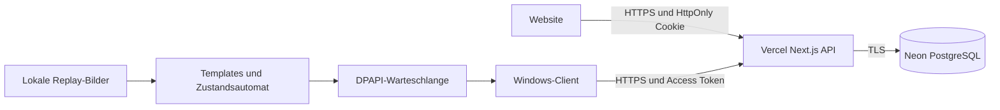

# Architektur

Für vier Nutzer werden Website und API gemeinsam auf Vercel betrieben. Next.js Route Handlers übernehmen Authentifizierung, Rechteprüfung, Validierung und Datenzugriff. PostgreSQL auf Neon ist die einzige gemeinsame Datenquelle. Die Datenbankadresse ist nur serverseitig verfügbar. Keine kontinuierlichen Bilddaten verlassen den Windows-PC.

## Live-Status

Die Website fragt authentifiziert im Abstand von einer Sekunde ab, solange sie sichtbar ist. Der Desktop sendet alle fünf Sekunden einen Heartbeat. Nach 20 Sekunden ohne Heartbeat zeigt die API offline. UNKNOWN, LOADING und MATCH_END_PENDING bleiben eigenständige Zustände. Ein offline gewordener Client beendet kein Match mit erfundenem Ergebnis. Reaktionszeit und Kosten hängen von Neon-Wakeup, Vercel und der Verbindung ab; eine Sekunde ist ein Ziel, keine Garantie.

## Sitzungen

Web: zufälliger opaker Token, nur SHA-256-Hash in der Datenbank, HttpOnly/SameSite-Strict-Cookie, im Produktionsmodus zusätzlich Secure. Mutationen benötigen exakt denselben Origin. 12 Stunden Laufzeit; Logout und Deaktivierung widerrufen Sitzungen.

Desktop: 15 Minuten Access-Token, 30 Tage Refresh-Token, rotierende Refresh-Tokens und Token-Familien. Erneute Benutzung eines widerrufenen Refresh-Tokens widerruft die ganze Familie. Token und Warteschlange werden mit Windows DPAPI an den angemeldeten Windows-Benutzer gebunden. Normale Konten haben keine Admin-Endpunkte.

## Datenkonsistenz

`(user_id,client_event_id)` ist eindeutig. Pro Nutzer darf nur ein aktives Match bestehen. Serverseitige Transaktionen verhindern doppelte Erfassung, Vier-Konten-Rennen und Änderungen ohne Audit. Die Statistik zählt gespeicherte Events; dadurch ist nach Korrekturen kein anfälliger Summencache zu reparieren. Die Durchschnittsberechnung berücksichtigt nur abgeschlossene Matches; Gesamttruhen umfassen alle Events, auch aus unvollständigen Matches. Matchdiagramme zeigen die tatsächlichen Eventzeitpunkte.

Die lokale Warteschlange speichert Befehle vor dem Versand und entfernt sie erst nach Erfolg. Jeder Befehl bleibt einem Server und Nutzer zugeordnet. Fehler werden nicht übersprungen. Start, Events und Matchende werden in dieser Reihenfolge übertragen. Nach Absturz wird ein gespeichertes aktives Replay beim Wiederanmelden als unvollständig mit dem letzten beobachteten Zeitpunkt abgeschlossen; es wird kein kompletter Spielausgang erfunden.

## Grenzen

Es existiert kein geografischer Inselpfad. Die Grafik zeigt den zeitlichen Truhenverlauf. Der Bildadapter verwendet normalisierte Graustufen-Korrelation in manuell kalibrierten HUD-Regionen; er setzt spezifische Templates voraus. Ohne echte Aufnahmen sind geeignete eigene Öffnungshinweise nicht nachgewiesen. Live-Capture wird nicht angeboten. Kein RAM-, Netzwerk-, Prozess- oder Spieldateizugriff.
